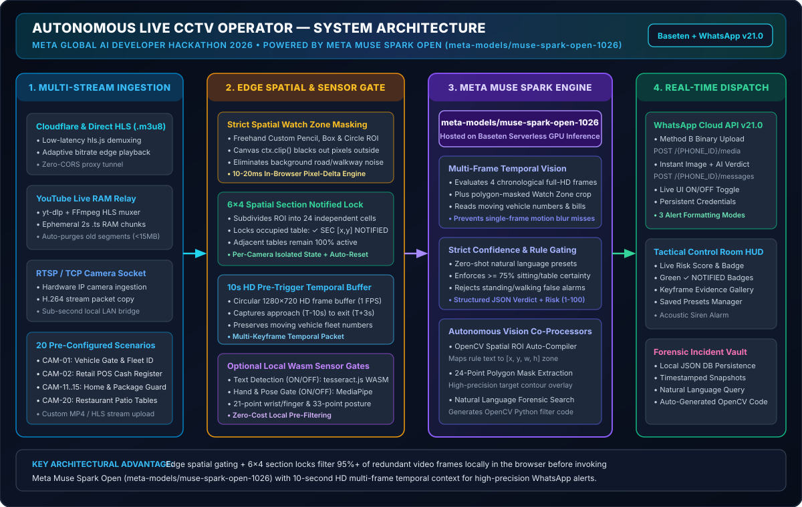
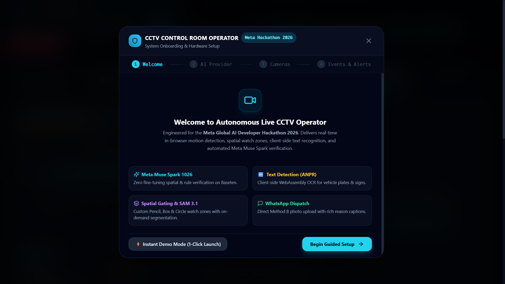
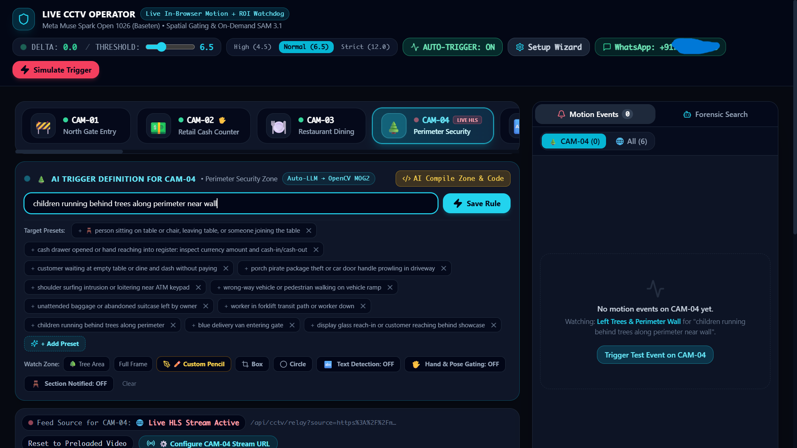
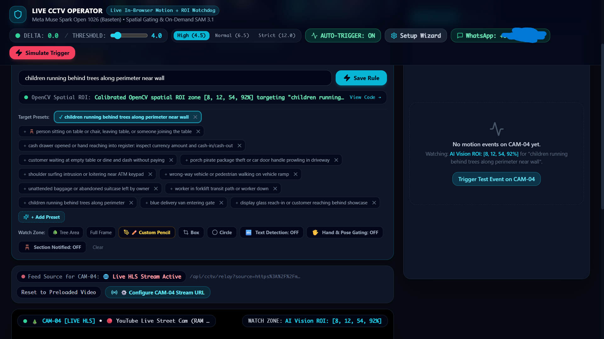
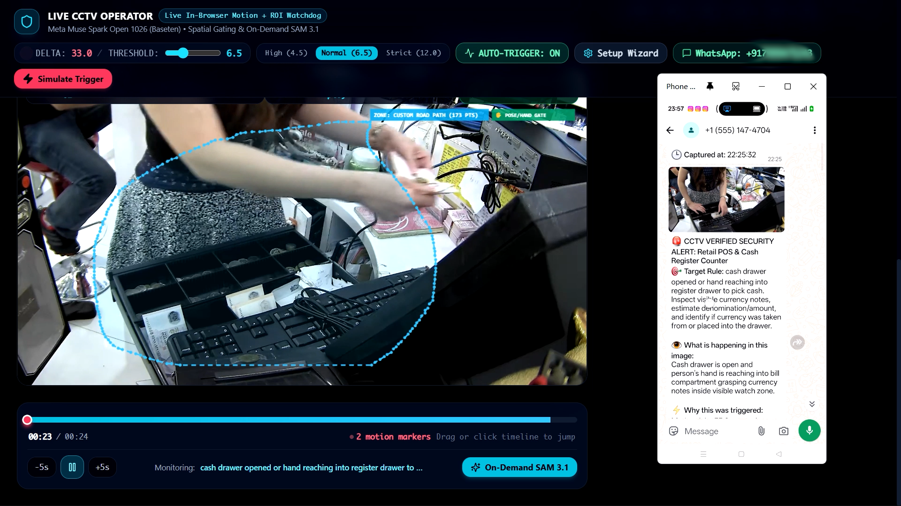
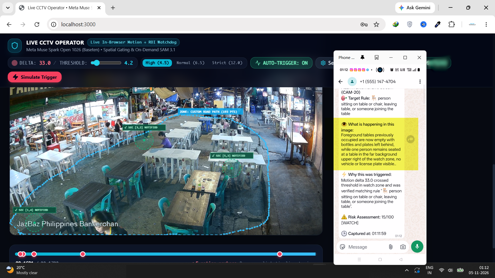

# Autonomous Live CCTV Operator • Meta Global AI Developer Hackathon 2026

[](https://baseten.co)
[](https://baseten.co)
[](https://nextjs.org/)
[](https://developers.facebook.com/docs/whatsapp/cloud-api)
[](LICENSE)

An **Autonomous AI CCTV Control Room Operator** engineered for the **Meta Global AI Developer Hackathon 2026**. Powered by **Meta Muse Spark Open (`meta-models/muse-spark-open-1026`)**, this platform transforms standard passive security cameras into intelligent, rule-driven autonomous operators that watch custom spatial zones, reason over multi-frame HD temporal sequences, and dispatch verified visual alerts with evidence snapshots directly to **WhatsApp** in real time.

---

## 🎯 Why We Developed This Project (Hackathon Motivation & Objective)

### The Problem with Traditional CCTV Surveillance
1. **Unmanned Feeds & Operator Fatigue:** Over 98% of commercial and residential CCTV video is never watched live—it is only reviewed *after* a theft, safety breach, or operational incident has already occurred.
2. **Legacy Motion Detection Floods Users with False Alarms:** Standard pixel-motion detectors trigger indiscriminately on swaying trees, passing shadows, pedestrians walking outside a property line, or waiters walking past a restaurant table.
3. **Alert Spam on Stationary Subjects:** In real-world scenarios—such as monitoring **restaurant table occupancy**—once a customer sits down, traditional detectors either spam dozens of duplicate alerts for the same seated person or lock the entire camera feed, blinding the system to new guests sitting at neighboring tables.
4. **Missed Fast-Moving Text & Fleet IDs:** Single-frame snapshots taken at the exact millisecond of a motion trigger often miss vehicle fleet numbers or license plates that were clearly visible 3–8 seconds earlier as the vehicle approached the gate.

### Our Project Objective
Developed specifically for the **Meta Global AI Developer Hackathon 2026**, our objective is to bridge **low-latency client-side edge computer vision** with **Meta Muse Spark Open (`meta-models/muse-spark-open-1026`)** multimodal reasoning and **Meta's WhatsApp Cloud API** to deliver:
- **Zero-Shot Natural Language Surveillance Rules:** Operators define what to watch for in plain English (or via 1-click industry presets) without training custom YOLO/CNN weights.
- **Strict Polygon Watch Zone Masking:** Freehand `✏️ Custom Pencil`, `▢ Box`, and `🔵 Circle` zones strictly clip and black out all pixels outside the user's drawn boundary before AI inspection, guaranteeing zero false triggers from background walkways or roads.
- **Per-Table / Per-Section Spatial State Locking (`6 × 4` Micro-Grid):** Subdivides watch zones into 24 independent spatial cells (`✓ SEC [col,row] NOTIFIED`) so seated restaurant guests trigger a single WhatsApp notification while adjacent empty tables remain 100% monitored.
- **10-Second HD Pre-Trigger Temporal Memory:** Maintains a rolling `1280×720` circular frame buffer (`T-10s` through `T+3s`) so Meta Muse Spark inspects chronological multi-frame sequences to accurately read moving delivery van fleet numbers and verify retail cash drawer transactions.

---

## 🏗️ System Architecture



### End-to-End Execution Pipeline

```mermaid
flowchart LR
    subgraph S1["1. Multi-Stream Video Ingestion"]
        A1["Cloudflare / Direct HLS (.m3u8)"]
        A2["YouTube Live RAM Relay (yt-dlp + FFmpeg)"]
        A3["RTSP / TCP Hardware Camera Socket"]
        A4["20 Built-In Multi-Domain CCTV Feeds"]
    end

    subgraph S2["2. Client-Side Edge Spatial & Sensor Gate (10-20ms)"]
        B1["Custom Pencil / Box / Circle Polygon Masking"]
        B2["6x4 Spatial Micro-Grid (Section Notified Lock)"]
        B3["10s HD Pre-Trigger Circular Frame Buffer (1280x720)"]
        B4["WASM OCR (tesseract.js) + MediaPipe Hand/Pose"]
    end

    subgraph S3["3. Meta Muse Spark Open (meta-models/muse-spark-open-1026)"]
        C1["Multi-Frame Chronological Sequence Reasoning"]
        C2["Strict Rule Verification (>=75% Sitting Confidence)"]
        C3["Autonomous OpenCV ROI & 24-Pt Polygon Compiler"]
        C4["Natural Language Forensic Query Engine"]
    end

    subgraph S4["4. Real-Time Incident Dispatch & Vault"]
        D1["Meta WhatsApp Cloud API v21.0 (Method B Binary Upload)"]
        D2["Tactical HUD + Green SEC [x,y] NOTIFIED Badges"]
        D3["Persistent Local Incident Vault (cctv_events_db.json)"]
    end

    S1 --> S2 --> S3 --> S4
```



### How the 4 Architectural Stages Work Together
1. **Stage 1 — Multi-Stream Video Ingestion:** Supports direct `.m3u8` HLS streams via `hls.js`, live YouTube streams relayed through an ephemeral RAM-backed FFmpeg HLS muxer (`/api/yt-relay`), hardware RTSP/TCP camera sockets (`/api/rtsp-relay`), and 20 pre-configured commercial, industrial, retail, residential, and hospitality camera feeds.
2. **Stage 2 — Client-Side Edge Spatial & Sensor Gate:**
   - Computes real-time pixel-delta motion inside the user's drawn ROI (`✏️ Custom Pencil`, `▢ Box`, or `🔵 Circle`) in `10–20ms`.
   - Masks out all pixels outside the polygon (`ctx.clip()`) so background movement never confuses the vision model.
   - Evaluates the `6 × 4` spatial micro-grid: if motion occurs inside an already-locked cell (`✓ SEC [x,y] NOTIFIED`), the API call is suppressed locally at zero cost; if a new table/section experiences activity, only that new section triggers analysis.
3. **Stage 3 — Meta Muse Spark Open (`meta-models/muse-spark-open-1026`) Multimodal Verification:**
   - Receives a chronological multi-image sequence (`T-8s`, `T-4s`, `T=0s`, `T+2s` at `1280×720` HD plus the polygon-masked ROI crop) alongside any local OCR text and hand/pose skeleton metadata.
   - Evaluates the operator's natural language rule, enforces a strict `>= 75%` confidence threshold for posture-sensitive rules (distinguishing seated guests from standing passersby), transcribes visible fleet/license numbers or currency denominations, and returns a structured JSON verdict (`matched`, `confidence`, `risk_score`, `summary`, `reasoning`, `detected_entities`).
4. **Stage 4 — Instant WhatsApp Cloud API v21.0 Dispatch:**
   - Converts the evidence frame into a binary JPEG buffer and uploads it directly to Meta's Graph API (`POST https://graph.facebook.com/v21.0/{PHONE_NUMBER_ID}/media`), then dispatches a formatted WhatsApp image alert (`POST /{PHONE_NUMBER_ID}/messages`) containing the AI verdict, confidence percentage, and risk score.

---

## 🖥️ Application UI & Complete Feature Walkthrough

### 1. Guided Welcome & Multi-Step Setup Wizard
First-time operators and hackathon judges are greeted by an interactive onboarding modal that explains the autonomous workflow, supports 1-click instant demo launch, and provides direct configuration for **Baseten (`meta-models/muse-spark-open-1026`)** and **Meta WhatsApp Cloud API** credentials.



---

### 2. Custom AI Trigger Definition & Natural Language Rule Presets
Operators can type any custom surveillance instruction in plain English or select from domain-specific quick presets (**🚚 Gate Vehicle & Fleet ID**, **💵 Cash Counter & Currency**, **🪑 Table / Chair Occupancy**, **📦 Package Theft Guard**, **🚗 Driveway & Car Watch**, **🧒 Kid & Pool Perimeter**, **👷 PPE & Hardhat Audit**). Clicking **Save Preset** persists the rule for instant reuse across cameras.



---

### 3. Saved Presets, Spatial Watch Zones & Edge Sensor Controls
Once a rule is active, **Meta Muse Spark** automatically compiles an initial OpenCV spatial region of interest, or the operator can manually draw and refine watch zones using the tactical toolbar directly below the live feed:
- **✏️ Custom Pencil / ▢ Box / 🔵 Circle:** Draw freehand polygons or geometric boundaries around specific tables, cash registers, or entry lanes. Pixels outside the boundary are masked out before AI verification.
- **🔤 Text Detection (`ON / OFF`):** Toggles the client-side WebAssembly OCR engine (`tesseract.js`) for license plates, fleet IDs, and signage.
- **🖐️ Hand & Pose Gating (`ON / OFF`):** Toggles local MediaPipe 21-point hand skeleton and 33-point body posture gating.
- **🪑 Section Notified (`ON / OFF`):** Toggles the `6 × 4` spatial sub-section occupancy lock (enabled by default for restaurant/table monitoring, and strictly isolated per camera).



---

### 4. Use Case A: Retail POS Cash Register & Currency Verification (`CAM-02`)
In this scenario on **CAM-02 (Retail POS & Cash Register Counter)**, the operator traces a **Custom Pencil** watch zone tightly around the cash register drawer and enables the **💵 Cash Counter & Currency** preset. When the cashier opens the till and counts banknotes, **Meta Muse Spark Open** verifies the hand-to-currency interaction inside the masked zone and dispatches a live WhatsApp photo alert with the verification reasoning.



---

### 5. Use Case B: Restaurant Patio Table Occupancy & Per-Section Notification Locks (`CAM-20`)
In this scenario on **CAM-20 (Live Stream 5 • Restaurant Patio)**, the operator outlines the dining tables with the **Custom Pencil** tool and runs the **🪑 Table / Chair Occupancy** rule:
- As patrons sit down at different tables within the patio zone, **Meta Muse Spark Open** verifies true seated posture (`>= 75%` confidence, ignoring standing passersby).
- Each occupied table section automatically locks on the canvas HUD with a green **`✓ SEC [3,2] NOTIFIED`**, **`✓ SEC [5,3] NOTIFIED`**, and **`✓ SEC [1,4] NOTIFIED`** badge so already-seated guests never trigger duplicate alerts, while newly arriving guests at other tables immediately trigger a fresh **WhatsApp** notification.



---

## 🛠️ Technology Stack

| Layer | Technology | Role in Architecture |
| :--- | :--- | :--- |
| **Multimodal Vision AI** | **Meta Muse Spark Open (`meta-models/muse-spark-open-1026`)** | Zero-shot rule verification, multi-frame temporal reasoning, OCR/currency verification, OpenCV ROI auto-compilation, 24-point contour extraction, and forensic search |
| **Inference Hosting** | **Baseten Serverless GPU API** (`inference.baseten.co/v1`) | High-throughput, OpenAI-compatible multimodal chat completions endpoint |
| **Frontend & Server** | **Next.js 14 (App Router)** + **TypeScript** + **React 18** | Real-time control room dashboard, server-side AI orchestration (`/api/verify-event`), and stream relays |
| **Edge Computer Vision** | **HTML5 Canvas Pixel-Delta Engine** + **`ctx.clip()` Polygon Masking** | `10–20ms` in-browser spatial motion detection, `6×4` micro-grid section locking, and 10-second `1280×720` circular pre-trigger frame buffering |
| **Client-Side Edge Sensors** | **`tesseract.js` (WASM OCR)** + **MediaPipe Hands & Pose** | Local optical text extraction and 21-point hand / 33-point body posture landmark gating |
| **Stream Demuxing & Relay** | **`hls.js`** + **`yt-dlp`** + **`ffmpeg`** | Browser HLS playback, YouTube Live RAM-chunk relay (`/api/yt-relay`), and RTSP/TCP camera ingestion (`/api/rtsp-relay`) |
| **Messaging & Alerts** | **Meta WhatsApp Cloud API v21.0 (Method B)** | Direct binary JPEG media upload (`/{PHONE_ID}/media`) + instant rich image alert dispatch (`/{PHONE_ID}/messages`) |
| **UI & Styling** | **Tailwind CSS** + **Lucide React** | Dark-mode tactical control room interface, responsive HUD overlays, and interactive setup modals |
| **Persistence** | **Local JSON Vault (`cctv_events_db.json`)** + **`localStorage`** | Incident snapshot logging, saved custom presets, and persistent WhatsApp ON/OFF & credential storage |

---

## 🚀 Quickstart & Installation Guide

### 1. Clone the Repository & Install Dependencies
```bash
git clone https://github.com/iamsourabhraikwar/meta-global-ai-developer-hackathon-2026.git
cd meta-global-ai-developer-hackathon-2026/live-cctv-operator
npm install
```

### 2. Configure Environment Variables
Copy `.env.example` to `.env.local` (or configure your keys directly inside the in-app **⚙️ API Setup** modal, which persists them automatically):
```bash
cp .env.example .env.local
```

```env
# Meta Muse Spark Open 1026 via Baseten
META_MUSE_API_KEY=your_baseten_api_key_here
META_MUSE_BASE_URL=https://inference.baseten.co/v1
META_MUSE_MODEL=meta-models/muse-spark-open-1026

# Optional: Meta WhatsApp Cloud API v21.0 (Method B Direct Binary Upload)
WHATSAPP_ACCESS_TOKEN=your_meta_whatsapp_access_token
WHATSAPP_PHONE_NUMBER_ID=your_whatsapp_phone_number_id
WHATSAPP_RECIPIENT_NUMBER=your_recipient_phone_number_digits_only
```

### 3. Start the Autonomous Control Room Server
```bash
npm run dev
```
Open **`http://localhost:3000`** in Google Chrome or Microsoft Edge.

---

## 🔒 Privacy & Security By Design
- **Zero Hardcoded Credentials:** All API keys, Meta access tokens, and recipient phone numbers are excluded from version control via `.gitignore` and stored locally in `.env.local` or browser `localStorage`.
- **WhatsApp Master Toggle:** Operators can toggle WhatsApp dispatching **ON** or **OFF** at any time directly from the top navigation bar (`📱 WhatsApp: ON / OFF`) without losing their saved credentials.

---

## 🏆 Built For
**Meta Global AI Developer Hackathon 2026**  
Developed by **Sourabh Raikwar** ([@iamsourabhraikwar](https://github.com/iamsourabhraikwar))
